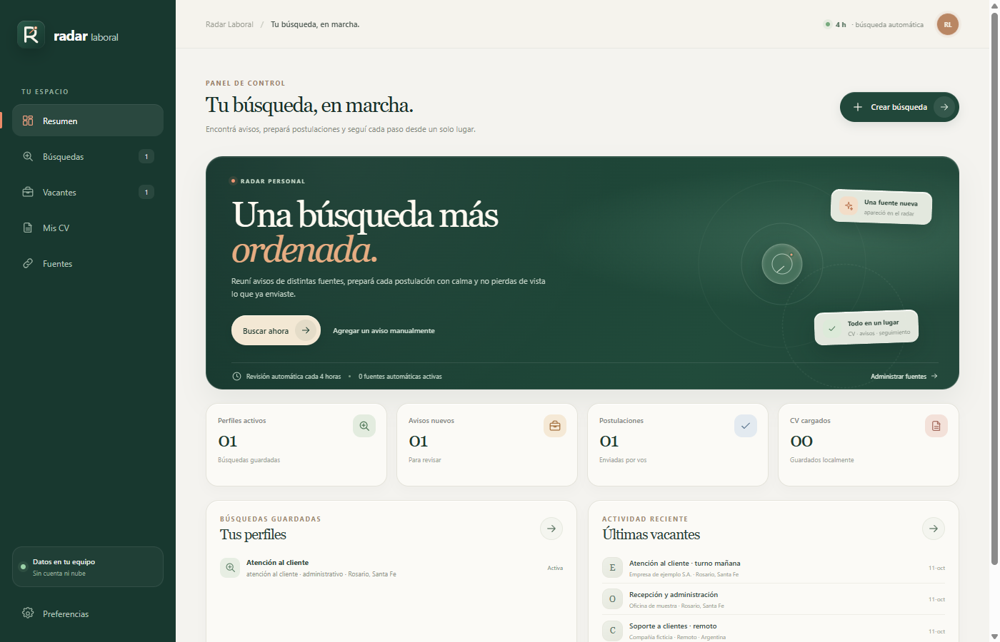
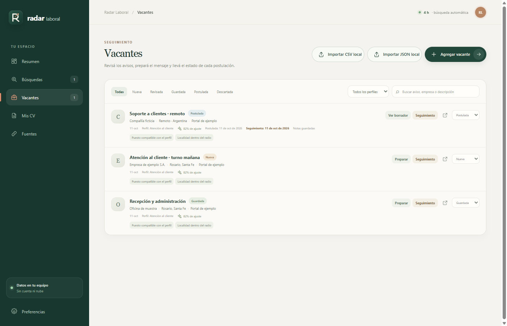
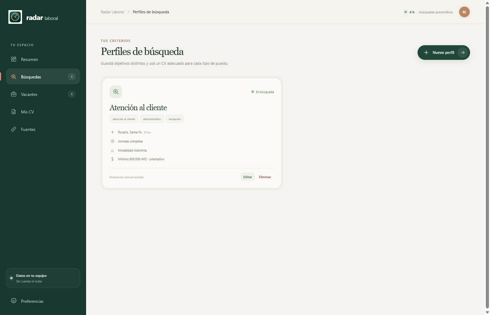

# Radar Laboral

**Una búsqueda laboral más ordenada, desde tu PC.** Reuní perfiles, vacantes, CV y seguimiento en una app de escritorio para Windows.

<p align="center">
  <a href="https://github.com/getodevel-source/radarlaboral/releases/latest"></a>
  <a href="LICENSE"></a>
  
</p>

<p align="center">
  <a href="https://github.com/getodevel-source/radarlaboral/releases/latest"><strong>Descargar Radar Laboral para Windows</strong></a>
  · <a href="docs/guia-de-uso.md">Leer la guía de uso</a>
</p>

## Una vista rápida

<table>
  <tr>
    <td width="50%" align="center">
      <a href="docs/images/resumen.png"></a><br />
      <strong>Todo en un solo lugar</strong><br />
      <sub>Perfiles activos, avisos nuevos y postulaciones.</sub>
    </td>
    <td width="50%" align="center">
      <a href="docs/images/vacantes.png"></a><br />
      <strong>Revisá cada oportunidad</strong><br />
      <sub>Entendé por qué coincide y qué información falta.</sub>
    </td>
  </tr>
  <tr>
    <td colspan="2" align="center">
      <a href="docs/images/busquedas.png"></a><br />
      <strong>Definí lo que estás buscando</strong><br />
      <sub>Guardá distintos perfiles para explorar objetivos diferentes.</sub>
    </td>
  </tr>
</table>

## Cómo te ayuda

- **Perfiles de búsqueda:** definí puestos, palabras clave, localidades, modalidad y sueldo mínimo.
- **Fuentes de empleo:** conectá fuentes automáticas verificadas, agregá feeds propios o abrí portales para buscar manualmente.
- **Vacantes ordenadas:** compará cada aviso con tus criterios, revisá qué datos faltan y seguí su estado.
- **CV y borradores:** guardá versiones PDF en tu equipo, prepará copias adaptadas y redactá mensajes para revisar.
- **Seguimiento:** registrá postulaciones, notas y fechas para retomar el contacto; Radar te avisa cuando llega el momento.

## Empezar

1. Creá un perfil en **Búsquedas** con el tipo de trabajo que te interesa.
2. Cargá tus CV en **Mis CV** y sumá portales o fuentes en **Fuentes**.
3. Revisá las coincidencias en **Vacantes** y decidí cuáles guardar o postular.
4. Anotá los próximos pasos en **Seguimiento**.

## Tus datos y tus decisiones

Los perfiles, las vacantes, los CV, los borradores y las notas se guardan en esta computadora. El texto de los CV se extrae localmente; el OCR para PDF escaneados también funciona en el equipo. Podés crear copias de seguridad desde **Preferencias → Copias de seguridad**. Las copias no están cifradas: guardalas en un lugar seguro.

Las búsquedas automáticas consultan las fuentes de empleo por internet; esas fuentes pueden ver la conexión de tu computadora, pero Radar no les manda tu perfil ni tu CV. La asistencia con IA es opcional: cuando la configurás y pedís un borrador, se envían al proveedor elegido el aviso, el texto del CV seleccionado y los datos de perfil que confirmaste. Revisá su política y sus costos antes de usarla.

Radar no inicia sesión en portales ni envía postulaciones por vos. Si un aviso no informa sueldo, fecha o localidad, la app lo conserva y señala qué no pudo comprobar. Las distancias entre localidades son aproximadas y se calculan en línea recta. Revisá siempre los datos del aviso y cualquier texto generado antes de usarlo.

## Descargar e instalar

1. Abrí [la última versión publicada](https://github.com/getodevel-source/radarlaboral/releases/latest).
2. Descargá `radarlaboral-Windows-<versión>-Setup.exe`.
3. Ejecutá el instalador y seguí los pasos en pantalla.

La app avisa cuando hay una actualización disponible. Encontrás los detalles en la [guía de instalación](docs/instalacion.md).

## Desarrollar

Se necesita Windows 10 o posterior y Node.js 24 o posterior.

```powershell
git clone https://github.com/getodevel-source/radarlaboral.git
cd radarlaboral
npm install
npm run dev
```

Comprobaciones y empaquetado:

```powershell
npm run typecheck
npm run lint
npm test
npm run build
```

`npm run build` genera el instalador de Windows en `release/<versión>/`. La [guía para instalar y publicar](docs/instalacion.md) explica la firma y las actualizaciones automáticas.

## Mapa del repositorio

| Carpeta | Contenido |
| --- | --- |
| `src/` | Interfaz React y tipos compartidos. |
| `electron/` | Proceso de escritorio, almacenamiento local, fuentes e integraciones de Windows. |
| `tests/` | Pruebas de las funciones principales. |
| `scripts/` | Capturas, comprobaciones, empaquetado y actualización de datos. |
| `resources/` | Iconos, datos geográficos y modelos de OCR locales. |
| `build/` | Política de seguridad y personalización del instalador. |
| `docs/` | Guías y notas técnicas; empezá por el [índice de documentación](docs/README.md). |
| `package-evidence/` | Informes de QA y huellas de versiones empaquetadas. |

Radar Laboral se distribuye bajo la licencia [MIT](LICENSE).
